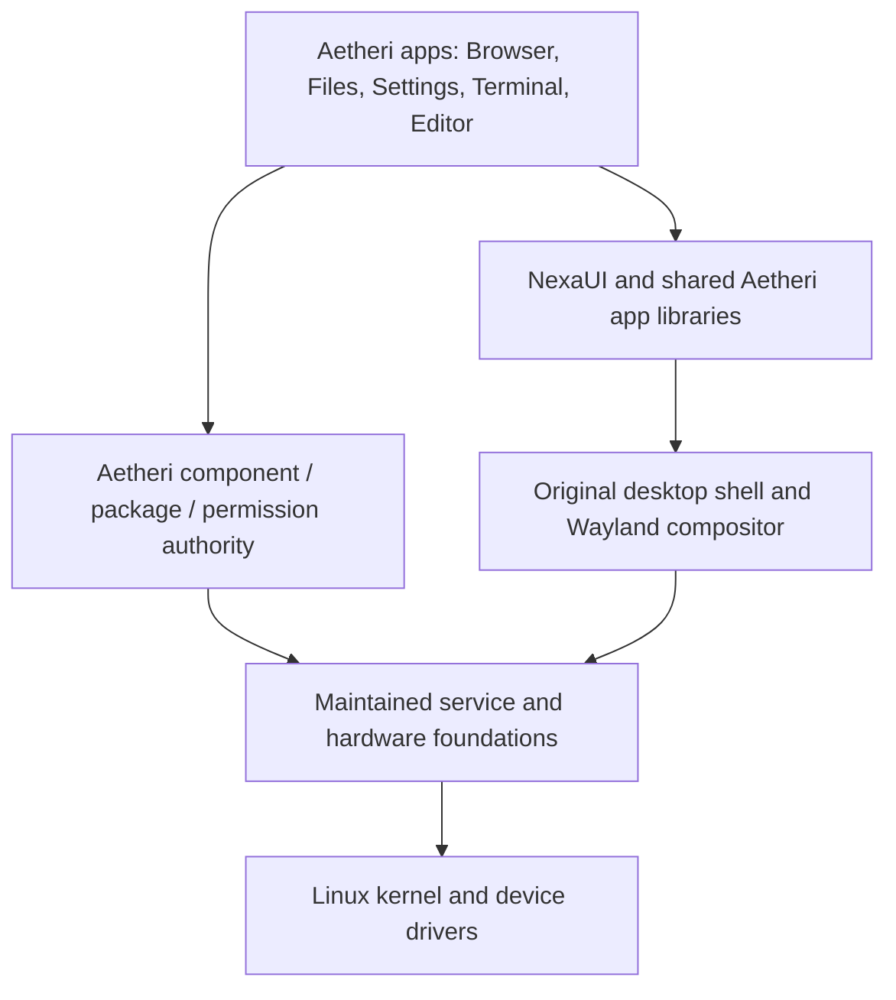

# Architecture options for Aetheri

25 October 2026. Status: proposed architecture, not a selected stack or implementation.
Suspend/resume is now a confirmed requirement on both target hardware profiles.
The language/runtime/license choices in [DECISIONS](../DECISIONS.md) remain settled.

## What we are choosing

Linux remains the kernel. These choices concern the userspace, desktop, software
lifecycle and update system; splitting userspace into processes does not turn Linux
into a microkernel. The build host need not be the shipped OS. Using an existing
distribution for bootstrap or tests does not require shipping its desktop or package policy.

### Three overall approaches

| Approach | Shape | Advantages | Costs |
| --- | --- | --- | --- |
| A: Distribution-derived desktop | Existing Linux distribution and package/update base, with original Aetheri apps and desktop components | Earlier access to integrated hardware, packages and security updates | Upstream layout/policies influence the product; two lifecycle authorities are a risk if layered carelessly |
| B: Controlled modular system | Defined system images from selected maintained components; original desktop, apps, permissions and lifecycle model | Strong product/file/process ownership while retaining difficult hardware/security foundations | We own integration, release engineering, dependency updates, installer and recovery acceptance |
| C: Deeper original userspace | Additionally write most compositor infrastructure, init/session/power coordination and related services from the beginning | More original implementation and control over internals | Much larger correctness/security/hardware burden; no established performance advantage |

Recommendation: B. It best matches a personal daily system, original UI and a
complete-removal model. This is an engineering judgment, not a measured speed ranking.
A can also support careful cleanup; it is not inherently incapable of it.
C is possible but duplicates difficult infrastructure before proving product value.

An original platform is not defined by rewriting every standard or library.
For B, build/release a known complete composition and explain every shipped dependency.
Do not copy an entire upstream source tree into this repository or maintain a hidden
second package manager that can independently change the same files.

## Proposed boundaries

This is a responsibility diagram, not an exact process count. Wayland rendering
and device access are separate from package management. Desktop visuals do not
run as root. Split the small privileged installation/permission operations from
unprivileged UI; do not build one all-powerful GUI or one daemon per menu.

The lifecycle authority owns installation/retention/grants metadata; the selected
supervisor owns live process state. The component view combines them rather than
introducing a second competing service manager.

## 1. Display server and desktop

A compositor combines application surfaces on physical displays, routes input,
manages focus and applies window/display policy. NexaUI draws application content.
These responsibilities are different.

| Option | Original work | Reused work | Main tradeoff |
| --- | --- | --- | --- |
| Existing complete compositor | Desktop shell/app UI and integrations | Existing window policy, display/input/protocol core | Faster integration, more constraints on deep window/effect behavior |
| Original compositor on wlroots | Window policy, scene/effects integration, shell protocols, lock/display policy | Modular backend, input/output and protocol/rendering primitives | Strong control with substantial real compositor work still required |
| Original compositor on libweston | Desktop/window policy and shell integration | Reusable Weston compositor/input/output/protocol infrastructure | Another viable C-oriented base; API and extension fit need comparison |
| Original low-level implementation | Nearly all display/protocol/input coordination | Kernel, selected drivers and basic libraries | Highest ownership burden and least early evidence for multi-monitor/resume behavior |

Recommendation: an original Wayland compositor on wlroots as the first candidate,
with libweston as the comparison fallback. Neither is approved by this document.
A tiny nested prototype must establish required client, buffer, sync, lock,
fractional-scale and output behavior before commitment. Core wlroots/libweston
capabilities do not certify a custom Aetheri compositor.

NexaUI remains the app toolkit candidate. Its current Linux build links both X11
and Wayland; a Wayland-first target still needs a scoped build review. Xwayland is
an optional compatibility layer, not an automatic base dependency. Selected browser,
Physim and NexaCloud paths must demonstrate the planned native Wayland behavior.

Do not force compositor, app toolkit and browser to use the same graphics API.
NexaUI Vulkan and a tested compositor GLES/Vulkan backend can coexist. Buffer sharing,
format compatibility, explicit synchronization and avoidable copies matter more
than making every module say Vulkan. Glass/blur effects remain custom rendering
work, with bounded redraw and opaque/reduced-effects fallbacks.

Intel laptop and NVIDIA desktop are separate hardware profiles sharing the same
architecture. A matching NVIDIA kernel module, userspace and firmware composition
may differ from the Intel/Mesa profile. Retain matching driver/kernel generations
through updates and rollback; do not infer NVIDIA acceptance from the Intel prototype.

## 2. Boot, service supervision and sessions

PID 1 starts early userspace and adopts/reaps orphan processes. A supervisor tracks
services and their children, handles stop/restart policy and failures. User sessions,
device access, login/lock and suspend coordination add further requirements.

| Option | Benefit | Additional work |
| --- | --- | --- |
| Selected systemd components | Existing lifecycle, cgroup/resource control, session/logind and sleep interfaces | Review exact installed components/units, privacy/log retention and integration surface |
| s6-based composition | Explicit supervision primitives and a modular ecosystem | Assemble boot dependencies, login/seat/power integration, policy and observability |
| Original init/supervisor | Full implementation ownership | Signals, child ownership, dependency/readiness rules, shutdown, privileges, sessions, recovery and sleep integration |

Recommendation for the first daily-use platform: selected systemd components
including session/sleep integration. This is a proposed new dependency choice.
It is not a proposal to install a whole distribution desktop or enable every
optional systemd service. Produce an inventory of actual binaries, libraries,
units and activation reasons. Do not claim it is small before measuring.

s6 is a credible alternative if minimizing that integration surface has greater
priority than reusing session/power coordination. Its supervision package is not
a complete desktop login/suspend stack by itself. An original supervisor could be
a later independently justified component, not a condition for having an original OS.

Use event/IPC APIs rather than periodic shell polling. D-Bus is a suitable existing
candidate for the maintained services' interfaces. Settings can be one UI over
BlueZ, audio, network and display backends; one UI does not require one process.
Resource/process accounting can use supervisor state and cgroups. cgroups are
accounting/control tools, not a complete app sandbox.

For a process map, distinguish always-needed kernel/session/compositor work, device
services enabled by feature, apps and their active helpers, and explicit developer jobs.
Choose process boundaries for privilege and failure isolation, then measure their costs.

## 3. Installed system and updates

| Option | Strength | Cost |
| --- | --- | --- |
| In-place writable package system | Familiar individual package changes and direct development access | More mixed-version/partial-update cases and global-file ownership complexity |
| Versioned read-only system deployments | Test and switch a complete known base, retain a bootable previous generation | More storage, explicit mutable configuration/data separation and migration design |
| Fully bundled isolated apps for everything | Clear individual ownership | Repeated large libraries unless shared runtimes/deduplication are designed |

Recommendation: versioned read-only base deployments plus independently versioned
app/tool packages. This is not a special filesystem requirement. Compare filesystem
and deployment tools later; an ext4-based design is possible, and Btrfs is not
automatically required. Fixed A/B partitions and versioned deployment directories/
images are different implementations of the same user-facing recovery objective.

The base contains a compatible kernel/initramfs, runtime, driver and core-service
composition. Prepare the next generation separately, verify it, select it for boot,
and mark it healthy only after meaningful startup checks. Keep a recovery path if
the new generation cannot reach the agreed usable state.

No update automatically overwrites user documents. Read-only system does not mean
read-only settings: machine configuration, service state and user data remain
writable through their own controlled boundaries.

A previous system image does not automatically undo a database migration, app data
or secrets. Versioned configuration/state schemas, migration reversibility, failure
handling and compatibility rules are required separately. Retained snapshots must
be visible in cleanup accounting.

RAUC and systemd-sysupdate illustrate maintained update mechanisms; neither is
selected. The inspected systemd-sysupdate manual explicitly labels it experimental,
so it should not be adopted solely because systemd is otherwise recommended.
Use the already agreed explicit installation choice and verified signed updates.

## 4. Package ownership, app state and permissions

A folder per app is helpful but not enforcement. An unrestricted program can still
write elsewhere or ask a powerful helper to do so.

Recommendation: declarative signed packages, immutable installed app code,
controlled private state, versioned shared runtimes and mediated access to external
files/devices. The permission policy must be enforced by kernel mechanisms and
narrow trusted services, not only by UI checkboxes or a voluntary coding convention.

Compare a maintained sandbox/portal base with original policy/UI versus assembling
a narrowly scoped launcher from Linux primitives. Namespaces, syscall filtering,
filesystem access restrictions, device and IPC policy solve different parts.
Neither a namespace nor a single sandbox flag establishes the complete guarantee.
Browser content isolation remains necessary inside the app-level boundary.

Existing portal interfaces are useful because apps can request a chosen document
without receiving access to the entire home directory. NexaUI needs an adapter;
no existing support is assumed. Our own desktop can supply the picker/permission UI
while reusing an agreed transport/interface.

Separate these ownership domains:

- System generations and essential shared runtime.
- Installed app/plugin/tool code and retained versions.
- Per-app/per-user settings, data, cache, logs and credential references.
- Machine-wide app/service state.
- User documents/projects explicitly independent of an app.
- Temporary files, permission grants and service registrations.
- Backups/rollback generations with visible retention.

Complete removal revokes owned registrations, stops owned work, removes selected
private state and frees unused dependencies. It preserves shared consumers and
independent documents, and explains all retained recovery data. Details and future
acceptance cases remain in [application lifecycle](app-lifecycle.md).

For the inventory store, compare an original transactional format with SQLite.
Recommendation: consider SQLite for durable metadata; it is an in-process library
without a database-server daemon. That is a new library proposal, not a selection.
Human-readable manifests describe signed packages; an authoritative transaction store
records the current installed state. Avoid two independently editable sources of truth.

A database transaction alone cannot atomically change a database, filesystem,
service state and boot configuration together. Installation/removal needs a
recoverable state machine and fault-injection tests across those boundaries.

Prefer conventional Linux internal paths for compatibility, with a component-oriented
view in Files/Settings explaining them. A new pretty root-directory hierarchy is
possible but requires loader/library/tool adaptation without a demonstrated benefit.
Do not confuse understandable visibility with scattering files or hiding ownership.

## 5. Shell, editor and plugins

The original Aetheri shell and language start together. A native C17 parser/evaluator
is a candidate implementation. This does not require a new machine-code compiler.
First specify language values, command execution, quoting/paths, errors, scripts
and background jobs. Byte streams for external tools and structured internal values
can coexist only with explicit conversion rules; choose that language behavior next.

Do not use the new shell as the mandatory interpreter for security-critical early
boot/update hooks. Keep service descriptions declarative and core privileged
operations in tightly scoped native code. This avoids coupling a changing language
to system recoverability.

Separate terminal presentation, PTY/session management, shell and editor.
Integrated panes do not imply embedding tmux itself. A session service should only
outlive terminal windows if the user chooses persistence. Surviving window close,
logout, reboot and suspend are different requirements.

Trusted first-party native modules can be part of the host package. Third-party
native plugins in the same process have the host's access and crash surface.
Recommendation: separate-process plugin execution with explicit capability/IPC
interfaces where isolation is needed; no idle plugin daemon merely because plugins
exist. A WebAssembly or script runtime is an alternative dependency to evaluate,
not automatically part of the system. All plugin code/state/grants need ownership
and full removal.

## 6. Suspend and recovery

Confirmed requirement, not an implementation result. Hibernate is a separate
unselected feature. Sleep-state choice depends on firmware, kernel and drivers;
do not prescribe the same state blindly for Intel and NVIDIA profiles.

Proposed sequence:

1. Receive manual/idle/lid request under explicit policy; check bounded inhibition
   for critical operations and user-visible reasons for postponement.
2. Establish a verified locked/covered display state before allowing sleep. If the
   lock path cannot establish its security condition, fail visibly rather than
   expose the desktop on resume.
3. Let apps/services prepare through supported session/sleep interfaces. Handle
   device/GPU transition using the selected platform's tested integration.
4. Resume displays/input to the lock state, then restore normal authenticated use.
5. Reconcile monitor layout/scaling, WLAN, Bluetooth/audio and app timing/state.
   Network connections may have expired; preserve truthful reconnect/error state.

The lock/compositor/session interaction needs its own threat model and acceptance.
Do not implement a fragile root hook that waits on already-frozen user processes.
The inspected systemd sleep docs warn that user.slice is frozen during sleep hooks;
supported pre-sleep/inhibitor interfaces are a different phase.

Physim must distinguish elapsed sleep from simulation time: a resume must not
accidentally advance the simulation by the wall-clock sleep interval. This needs
a separately tested app timing contract, regardless of the later NexaUI migration.

Acceptance includes repeated cycles with three displays where available, mixed
scale/refresh cases, GPU rendering, lock visibility, input, jack/Bluetooth audio,
WLAN reconnection, background jobs and interrupted/blocked operations. Test both
target profiles, monitor hotplug around sleep, and resource growth across cycles.
VM sleep tests do not establish physical driver/power behavior.

## Recommendation and decision scope

Proposed package of decisions:

1. Overall B: controlled modular system with original desktop/apps/lifecycle.
2. Wayland-first original compositor; evaluate wlroots first, libweston as comparison.
3. Selected systemd/session/sleep foundation for the first daily-use platform,
   with the precise installed/activated set exposed and measured.
4. Versioned read-only base plus independently managed apps/tools, enforced
   private-state boundaries and one authoritative component inventory.

These are recommendations for user discussion, not adopted dependencies.
SQLite, sandbox/update implementation, compositor version and the browser engine
remain specific follow-up choices. Keep the approved C17/targeted Rust/glibc/MIT
foundation intact.

Before implementation commitments, perform bounded prototypes in this order:
document/validate package lifecycle and recovery model; isolated nested compositor/
NexaUI interaction; coherent boot image in QEMU; chosen session/permission/sleep
integration; laptop hardware; separate NVIDIA profile. Use prototypes to reveal
missing prerequisites rather than claiming boot or hardware success from source code.
Do not modify existing projects or their active migrations.

## Sources read

- [Wayland architecture](https://wayland.freedesktop.org/architecture.html)
- [wlroots API](https://wlroots.pages.freedesktop.org/wlroots/)
- [libweston](https://wayland.pages.freedesktop.org/weston/toc/libweston.html)
- [systemd lifecycle](https://www.freedesktop.org/software/systemd/man/latest/systemd.html)
- [session/sleep API](https://www.freedesktop.org/software/systemd/man/latest/org.freedesktop.login1.html)
- [systemd sleep](https://www.freedesktop.org/software/systemd/man/latest/systemd-sleep.html)
- [s6 overview](https://skarnet.org/software/s6/overview.html)
- [RAUC](https://rauc.readthedocs.io/en/latest/basic.html)
- [systemd-sysupdate status](https://www.freedesktop.org/software/systemd/man/latest/systemd-sysupdate.html)
- [Flatpak sandbox/portals](https://docs.flatpak.org/en/latest/sandbox-permissions.html)
- [Landlock](https://docs.kernel.org/userspace-api/landlock.html)
- [cgroup v2](https://docs.kernel.org/admin-guide/cgroup-v2.html)
- [SQLite in-process model](https://www.sqlite.org/serverless.html)
- [SQLite transaction limits/assumptions](https://www.sqlite.org/atomiccommit.html)
- [Kernel sleep states](https://docs.kernel.org/admin-guide/pm/sleep-states.html)
- [NVIDIA matching components](https://github.com/NVIDIA/open-gpu-kernel-modules)

Live documentation was used for comparison. No exact versions, license graph,
security status, feature completeness or hardware benchmark is certified here.
