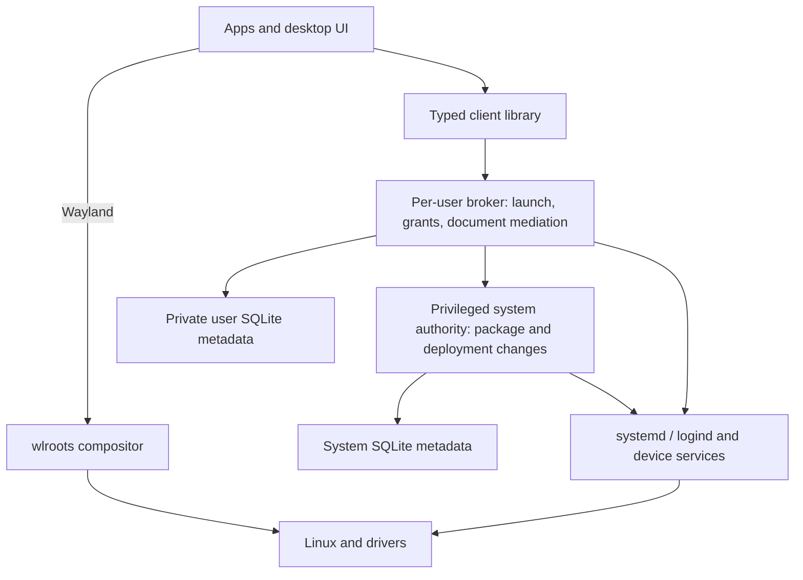

# Module and interface plan

25 October 2026. Status: proposed detailed design within the approved B/wlroots/
systemd/SQLite architecture. Module names and interfaces below are descriptive;
there are no installed executables, implemented APIs or fixed wire schemas yet.

## Goals and rules

Every responsibility has an owner. Each persistent fact has one authoritative
writer within its scope. Modules are logical boundaries, not necessarily processes.
Separate privileged mutation from unprivileged rendering and ordinary app work.

The plan must support complete managed-state removal, independent apps, controlled
permissions, offline operation, recoverable updates, Intel/NVIDIA profiles and
required suspend/resume. Do not recreate systemd's supervisor or a hardware backend
inside an Aetheri daemon.

## Responsibility and process map

| Module | Responsibility / authoritative state | Proposed runtime form |
| --- | --- | --- |
| Build and release | Pinned inputs, target profiles, manifests, images, license/verification records and signing pipeline | Development tools; no installed resident build service |
| Platform foundation | Kernel, drivers, systemd service/session lifecycle and maintained hardware backends | Existing configured processes/modules; inventory their actual installed/active set |
| Compositor | Wayland surfaces, focus/input routing, physical outputs, composition, secure lock enforcement | Original wlroots-based compositor while a graphical session runs |
| Desktop shell | Dock, launcher/global search UI, desktop visuals and notification presentation | Original unprivileged NexaUI client, restartable separately from compositor |
| User broker | Trusted app launch records, per-user grants/integrations and mediation for apps | One trusted broker per active user; shared across that user's sessions with explicit session/seat identity |
| System authority | Package/store ownership, base deployments, machine-wide operations and recoverable change journal | Small privileged service, activated on demand; scoped helpers/workers only when needed |
| Document and permission mediation | Selected-file/device access, trusted picker workflow and grant lifetime | Logical user-broker modules plus an on-demand UI/backend; not a mandatory daemon per capability |
| Authentication / lock | Authentication through a maintained backend; trusted lock presentation | Restricted authentication path and lock UI only when required; no passwords in desktop-shell code |
| Device adapters | Translate display/audio/WLAN/Bluetooth operations and observed backend state | Shared client code or narrow broker modules calling the actual backend; no replacement hardware state database |
| Shared app libraries | NexaUI, typed Aetheri client API, reusable text/document/model code | In-process libraries, not services |
| Applications | Browser, Terminal, Editor, Files, Settings/Software, Physim and NexaCloud workflows | Independent app processes and justified helpers |
| Terminal sessions and plugins | PTYs/jobs, pane/session state and extension execution | App-owned workers; separate persistence only when explicitly selected |

Working names: aetheri-compositor, aetheri-desktop, aetheri-user and aetheri-system.
These names are placeholders for discussion, not commands users can run.

The user broker has one writer for its private database even with multiple logins.
It must route consent and desktop actions to the correct authenticated session/seat.
Logout, last-session exit and explicitly permitted background work need clear lifetime
policy; do not enable persistent user-service lingering by default.

The compositor remains outside the desktop-shell crash boundary. If the desktop
shell fails, it can restart without replacing the display server. If the compositor
fails, client connections/session state may be lost: require a controlled locked
recovery/login path, not a promise that all windows seamlessly survive.

## Dependency and trust diagram

Control arrows do not carry every frame or file byte. No GUI directly writes the
system registry. Some trusted backend adapters can call existing permitted APIs
directly; route through a broker when identity, grants or lifecycle policy require
mediation, not merely to add an extra hop.

Authentication validates identity through a maintained stack; logind manages
sessions and seats, not an entire password-validation mechanism by itself.
PAM/polkit and the exact authentication integration require a separate dependency/
threat-model review before adoption. No original password cryptography is proposed.

## Interface choices

| Boundary | Recommended mechanism | Why |
| --- | --- | --- |
| Within an app/library | C APIs with explicit ownership and opaque handles where appropriate | Avoid unnecessary serialization/process hops |
| Small cross-process control | Typed local D-Bus interfaces; sd-bus as the first C binding candidate | Existing systemd/device ecosystem and asynchronous calls/signals |
| Windows/input/display | Wayland and selected standard/private protocols | Keep rendering/input on the intended display path |
| File/document access | Scoped descriptors or document grants, with portal interoperability | Avoid blanket home-directory access and repeated path interpretation |
| Large streams/data | Dedicated pipe/socket, bounded shared buffer or descriptor transfer as appropriate | Do not move PDFs, pixel frames or transfers through ordinary control messages |
| App jobs and resources | systemd units/scopes and cgroup integration | One supervisor remains authoritative for actual child/process state |

D-Bus is a protocol/transport, not proof of caller authority. It has a real bus
implementation/service whose footprint and lifetime must be included in the
inventory; sd-bus is a library and is not that bus service. No Internet server or
HTTP API is necessary for local Aetheri management. Exact bus implementation,
policy and binding versions remain to be selected.

An application must not become privileged by sending an AppId string. Bind each
request to authenticated peer credentials, a trusted launcher record, installation
generation and process incarnation. UID alone does not distinguish apps sharing
a user. Do not rely on a recycled PID or a self-selected D-Bus name. Restrict
sandbox access to privileged/systemd/session buses and prevent app children from
escaping the launch/ownership boundary through an unrestricted helper.

The exact launch-identity, sandbox and bus-filter mechanism needs a security design;
the diagram is not a security proof. Developer shells/unmanaged programs with broad
user access must be visible exceptions to the managed guarantee.

## Ownership and data model

### System authority database

Only the system authority writes machine installation/deployment metadata through
validated operations. Clients receive bounded, authorized projections rather than
SQL access. Candidate entities:

- Component identity, release/digest, manifest, source/license and explicit install reason.
- Installed generations, ownership records, active version and retained recovery versions.
- Dependency edges, explicit pins, users/consumers and pending cleanup/leases.
- Package integrations and registered service/unit relationships.
- Desired deployment, observed activation evidence and health/rollback state.
- Change operations, validated plan revision, idempotency binding and recovery steps.

### User broker database

One trusted writer per user owns per-user installation associations, private grant
metadata, retained-data choices, integration preferences and durable user-operation
receipts. Other users cannot read private history/paths merely to draw a global
component list. Root and user databases are different ownership scopes, not one
globally writable registry and not one pretend cross-user atomic transaction.

### App and runtime state

Apps own their data within their assigned areas. User documents remain independent
unless deliberately classified otherwise. Settings changed by an app are not
automatically system-wide configuration.

Live PID/worker/readiness status comes from systemd and trusted launcher state,
not stale SQLite rows. Device connection/volume/mode state comes from the backend.
Caches of observed state must carry freshness and be reconciled after restart.

Secret values and release signing keys do not belong in the component registry.
Store references to the chosen protected credential backend; select that backend
separately. Ship verification keys as appropriate, not private release-signing keys.

SQLite transaction/journal settings, filesystem flush behavior and schema versions
must be chosen/tested. Do not choose WAL merely for a headline performance claim.
SQLite journal/WAL/shared-memory files, when used, are owned recovery/runtime files
with a known purpose, not unexplained litter to delete while a database is active.

A SQLite commit does not commit filesystem mutations, remote backend state or boot
selection. Use a persistent operation state machine, recoverable stages and explicit
receipts for each authority. If metadata is corrupt, stop destructive changes and
recover from verified records; never treat an empty rebuilt registry as proof that
all existing files/dependencies are unused.

## Draft API families

These are semantic contracts, not finished D-Bus signatures or an implemented ABI.

| API family | Caller and owner | Example input / result |
| --- | --- | --- |
| Components | Authorized UI/CLI to system authority, user projection through broker | Filter/page request -> component summary, ownership/retention reasons, revision |
| Plan change | Software UI/CLI to relevant authority | Install/remove/purge target and scope -> immutable preview, affected generations, retained items and plan token |
| Apply / observe operation | Authorized caller to operation owner | Plan token + expected revision + request key -> operation ID; later progress/final report |
| Launch app | UI/shell to user broker -> supervisor | Installed app/action, session and allowed document grants -> launch identity and observed startup state |
| Request document | App through SDK to document mediator | Read/save request -> trusted chooser flow and selected-file access, or cancel/deny |
| Device settings | Settings via scoped backend adapter | Explicit device/operation/revision -> observed result or policy/backend error |
| Preview display layout | Trusted Settings to compositor | Output/mode/scale proposal + current revision -> temporary layout token and rollback deadline |
| Lock / suspend | Session UI/broker through compositor/auth/logind integration | Reason/policy -> locked readiness and sleep preparation, visible inhibit/failure or resume state |
| Extensions / jobs | Host app/broker and worker ownership | Versioned capability request -> scoped plugin/job handle and lifecycle events |

An accepted asynchronous request is not a completed installation or a usable app.
Represent queued, validating, staging, applying, succeeded, failed, cancelled and
recovery-required states explicitly. Exact enums will be finalized per contract.

Common rules:

- Version wire schemas and behavior. Support capability discovery; reject unsupported
  required features rather than silently weakening a request.
- Bound message size, strings, array lengths, handles, queued requests and worker
  resources. Define exact limits during contract implementation.
- Validate encoding. OS paths may contain non-UTF-8 bytes even if display labels use
  UTF-8; do not conflate display strings, raw paths, URIs and trusted file access.
- Give errors stable machine codes plus safe human explanations. Permission denied,
  unsupported capability, stale plan, busy, cancellation and partial recovery differ.
- Bind retry keys to caller, request contents, scope and generation. A timeout means
  outcome unknown, not automatic failure; query/retry the same operation identity.
- A preview is advisory until execution revalidates it. Changed dependencies, scope
  or generations require a new/reviewed plan rather than blindly applying stale consent.
- Cancellation is cooperative and phase-aware. Once irreversible work is committed,
  report what completed and what recovery/cleanup remains.
- Events carry a service incarnation and monotonic sequence/revision. On a gap or
  reconnect, fetch a fresh snapshot; notifications are not the only durable record.
- UI/client disconnect does not silently undo a committed system operation.
- No arbitrary privileged command strings, arbitrary SQL or unrestricted backend
  proxy calls. Use narrow operations with server-side authorization.
- Keep UI threads responsive. No blocking callbacks under authority/database locks.

## End-to-end examples

### Start an application

The launcher asks the user broker for an installed app action. The broker checks
that the selected generation is launchable and not being removed, prepares its
private storage/allowed capabilities and asks the supervisor to start it.
The trusted launch record binds app identity to the actual running incarnation.
The app creates a Wayland window; the compositor routes it under the desktop policy.

Metadata cannot claim launch success just because a service start was queued.
A start failure produces an observed error; an app crash is not an uninstall.
A removal operation closes the launch gate before stopping selected app processes.

### Open and save a PDF

The app requests a document action. A trusted Aetheri picker lets the user select
a file. The mediator opens/grants the selected resource with the requested scope;
the app renders it without receiving blanket write access to the home directory.

Portal interoperability needs an explicit adapter: XDG FileChooser returns selected
URIs, not the invented promise that every standard call directly returns an FD.
Our SDK can expose a scoped native handle or resolve a portal/document grant.
Saving must define overwrite, temporary file, sync/publication and failure semantics.

Revoking metadata does not generally invalidate an already-open descriptor or undo
data already read. Define future-open revocation versus termination/restart of
existing holders. Complete removal must account for owned workers and transferred
access, not merely remove the grant row.
If access was deliberately delegated beyond the removable process scope, show
the remaining lease/holder limitation rather than killing unrelated applications
or promising physical erasure of data they may still hold.

### Install or completely remove an app

Validate a signed manifest/source and compute an ownership/dependency/storage preview.
Execute only an authorized current plan. Stage code in a bounded controlled area,
verify it and publish an installed generation without arbitrary root installer hooks.

For removal: block new launches; stop/reconcile the affected ownership scope;
revoke integrations; remove selected private state and code; release dependency
references; clean genuinely unused objects; report retained and failed items.
Record recovery stages and do not make a fresh reinstall vulnerable to an old
cleanup job: identities include generation, not just the same app name/path.

Other-user data, unavailable encrypted user storage, explicit pins, active consumers
and recovery versions can prevent immediate global cleanup. Show pending/retained
state and why; do not display complete purge while known owned residue remains.
Independent documents, exports, remote copies and backups are separate choices.

### Update the system

The system authority plans a complete compatible base generation, including the
kernel/driver composition. A bounded worker downloads/verifies/stages it on explicit
request. Private signing keys remain outside the target. Existing deployment stays
usable until the new one is ready.

Boot selection and health confirmation are separate stages. A successful database
write alone is not evidence the new system booted. Retain a working recovery path.
Mutable database/configuration compatibility must be validated for rollback.

Do not roll back uninstall intent or resurrect purged app credentials just because
an older base is booted. User/data changes and app generation retention need their
own compatible policies. Automatic update polling is not a required always-on worker.

### Change displays and suspend

Settings requests a temporary compositor-owned display layout. Validate the actual
outputs and modes, retain the last working layout and use a compositor-owned timeout.
If the UI dies or confirmation never arrives, revert; test failures where hardware
cannot restore the old mode and provide a recovery path. Do not rely on the Settings
process remaining alive to save a black-screen configuration.

Before suspend, coordinate bounded critical-operation inhibitors, verified locked
display readiness, app preparation and logind/kernel/device transitions. A failed
lock preparation must not be treated as success. Resume into a trusted locked state
and reconcile outputs/input/audio/Bluetooth/network state.

The compositor enforces the lock; the desktop shell cannot simply draw a cosmetic
password window over the session. If a lock client dies, remain covered/locked until
a trusted recovery path is established. Compositor failure is a separate case.
Hardware paths need independent Intel and NVIDIA acceptance; Physim must not advance
simulation time by the wall-clock sleep duration.

## Process lifetime and failure behavior

| Failure / lifetime | Required outcome |
| --- | --- |
| UI crashes during install | Durable operation remains queryable; UI reconnect does not duplicate it |
| Desktop shell crashes | Restart UI without unnecessarily replacing compositor or apps |
| Compositor crashes | Fail closed/recover login/session; do not promise surviving Wayland clients |
| User broker restarts | Reconcile launcher/supervisor state; no implicit new grants |
| System authority restarts | Recover incomplete changes; no blind replay or duplicate publish |
| Device backend unavailable | Show unavailable/reconnecting; do not present cached state as current |
| Metadata unavailable/corrupt | Reject destructive changes, preserve data and enter explicit recovery |
| Plugin unused | No worker required merely because it is installed |
| Terminal window closes | Follow selected persistence policy; not automatically logout/reboot persistence |

Normal graphical use needs compositor, desktop UI, user/session foundations and
the bus/device services actually required. The system authority and heavy workers
can be activated when needed, provided recovery and client subscriptions permit
idle exit. No fixed process-count promise before measurements.

Keep bounded, owned, privacy-conscious logs with retention visible in the component
view. Do not log credentials or full private document contents. Search starts with
installed app metadata and explicit scopes; no hidden whole-disk indexing assumption.

## Source organization proposal

Create directories only when implementation needs them:

- system: original authorities, domain logic and maintained-backend adapters.
- desktop: compositor, desktop shell and trusted lock integration.
- apps: app-specific behavior and UI.
- libraries: shared client APIs/models and reusable app code.
- platform: boot/kernel/service/sandbox/image configuration and hardware profiles.
- tools: build, dependency preparation, release and validation tooling.
- tests: interface, recovery, isolation and hardware fixtures.
- brains: current project memory; later user guides get their own justified location.

These are proposed source categories, not directories already created. No separate
repository/service/file for every logical feature. Downloaded third-party sources,
builds/caches/VMs stay separate under our approved workspace and out of Git.

## Recommendation and acceptance scope

Recommend the two authority scopes, compositor/UI separation, in-process shared
libraries, typed local control IPC, a per-owner SQLite writer model and explicit
recoverable operations. Reuse systemd/backend interfaces instead of implementing
duplicate live-state managers.

The user has approved B/wlroots/systemd/SQLite; these finer interface, process,
storage and helper choices remain a proposal. No schema, bus policy, authentication
backend, sandbox engine, executable list or precise resource limit is fixed here.

Next contracts should cover package/operation identity and recovery first, then
trusted launch/document grants, followed by compositor/UI/session integration.
For each, test wrong caller, stale generation, duplicate requests, disconnect,
full disk, process death, missed events and schema incompatibility as applicable.
Do not confuse a mocked backend result with real device/privilege acceptance.

## Primary sources inspected

- [D-Bus specification](https://dbus.freedesktop.org/doc/dbus-specification.html)
- [sd-bus](https://www.freedesktop.org/software/systemd/man/latest/sd-bus.html)
- [Bus credentials](https://www.freedesktop.org/software/systemd/man/latest/sd_bus_get_name_creds.html)
- [systemd service API](https://www.freedesktop.org/software/systemd/man/latest/org.freedesktop.systemd1.html)
- [logind session/sleep API](https://www.freedesktop.org/software/systemd/man/latest/org.freedesktop.login1.html)
- [FileChooser portal](https://flatpak.github.io/xdg-desktop-portal/docs/doc-org.freedesktop.portal.FileChooser.html)
- [SQLite atomic commit](https://www.sqlite.org/atomiccommit.html)
- [SQLite WAL](https://www.sqlite.org/wal.html)
- [wlroots session-lock API](https://wlroots.pages.freedesktop.org/wlroots/wlr/types/wlr_session_lock_v1.h.html)
- [Linux open descriptors](https://man7.org/linux/man-pages/man2/open.2.html)
- [Local sockets and descriptor/credential passing](https://man7.org/linux/man-pages/man7/unix.7.html)

Read live documentation on 25 October 2026. Specific versions, schema signatures,
security properties and performance remain subject to implementation and validation.
