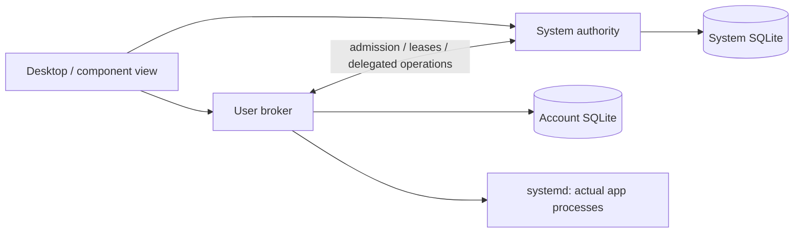

# SQLite schema and management API

25 October 2026. Initial schema/API contract accepted by the user following the
[identity/lifecycle model](identity-and-lifecycle.md). The SQL and XML are executable
contract artefacts, not installed services or production catalogues.
The [filesystem/permissions direction](filesystem-and-permissions.md) is now
accepted. The next [launch/access protocol proposal](launch-access-and-removal.md)
specifies workflows and identifies additional grant/edit/gate records and methods.
These additions are not implemented by the existing SQL/XML nucleus.
The [P0 proposal](first-linux-prototype.md) now defines a minimal first extension
and keeps its future migration separate from the current source contracts.

This is the first management nucleus; device settings, document grants, credential storage,
plugins and boot deployment have not acquired complete APIs through this document.

## Files and ownership

| File | Purpose |
| --- | --- |
| [common-v1.sql](../../../spec/schema/common-v1.sql) | Seven shared table definitions: authority, plans, effects and operation recovery |
| [system-v1.sql](../../../spec/schema/system-v1.sql) | Seven system-owned component, installation, activation and reference tables |
| [user-v1.sql](../../../spec/schema/user-v1.sql) | Four account-owned binding, private-data and launch tables |
| [management-v1.xml](../../../spec/api/management-v1.xml) | Exact argument order, directions and D-Bus types for 14 proposed methods |
| [validate_contracts.py](../../../tools/validate_contracts.py) | Disposable in-memory constraint cases and structural XML checks |

Recommend one system catalogue and one catalogue per account, with one trusted
writer for each. Common definitions occur in both; there are 14 tables in a system
catalogue and 11 in a user catalogue, covering 18 distinct table designs.
They do not imply 18 processes. SQLite runs inside the owning authority.

A single globally writable database would simplify joins but cross the privacy
and privilege boundary. A database per app would lose one coherent authoritative
installation/removal inventory. Apps may keep their own application databases
inside managed private storage; those are not administrative catalogues.

These SQL files bootstrap new empty test catalogues. Load common first, then one
owner-specific file. They are deliberately not rerunnable migrations. Production
locations, filesystem ownership and access confinement still require the storage
and sandbox design. Ordinary apps must not open, replace or edit these catalogues,
including the same-account broker database; Unix UID separation alone does not
enforce that latter boundary.

## Values and constraints

Local object IDs use 16-byte BLOBs in SQLite and byte arrays (`ay`) on D-Bus.
Generate local UUIDv4 IDs through an OS cryptographic random source. Validate
format/version/variant where the value is an Aetheri-generated UUID; observed boot
and supervisor invocation identifiers are opaque 16-byte values with their own
producer semantics. Display UUIDs as conventional strings in diagnostics.

Artifact and intent digests use 32-byte BLOBs/`ay`. Recommend SHA-256 for the v1
digest suite. This does not finalize the package manifest, signed envelope or
canonical hashing format. Their byte format and fixed test vectors are release
blockers before any real artifact publication. An ID-sized blob or hash is not a
publisher signature.

Component IDs contain 1–128 lower-case ASCII letters, digits, periods, underscores
or hyphens. Action IDs have the same alphabet and a 64-byte limit. Display names
are 1–256 UTF-8 bytes; release labels 1–128 bytes. The API rejects invalid UTF-8,
embedded NULs and over-limit values before allocation/storage. SQL applies type,
length and selected alphabet constraints; it is not a complete wire validator.

The tables use STRICT typing. Foreign keys are enabled and verified on every
connection, before transactions. A primary key identifies one row; a foreign key
requires a referenced row; UNIQUE prevents competing identities/enrollments; CHECK
restricts valid values and combinations. SQL NULL means absent. At the wire
boundary an optional identifier is an empty byte array, never an all-zero fake ID.
A required ID cannot be empty.

Revisions start at 1, increase in the same transaction as their relevant change,
and never wrap. SQLite integers and stored D-Bus `t` values must fit signed 64-bit
range, despite `t` permitting a larger unsigned range. Catalogue revisions support
paged snapshots; entity revisions support targeted plan validation. Reference or
policy changes must update the relevant revision too. The trusted writer performs
these revision updates; generic SQL triggers do not infer every business change.

## Shared plan and operation tables

| Table | Main fields and reason |
| --- | --- |
| authority_meta | Singleton owner kind, persistent AuthorityEpoch, current BootId, account ownership and catalogue revision |
| plans | PlanId, authenticated actor, scope, operation kind, exact targets, retention, action, digest, boot/deadline and consumption state |
| plan_reads | Relevant source epochs, object references and expected revisions; detects stale inputs without rejecting unrelated changes |
| plan_effects | Numbered preview effects, exact target IDs, disposition and machine-readable reason |
| operations | OperationId, unique plan/actor/request binding, state, phase, reason, outcome, audit times, result and revision |
| operation_steps | Numbered durable steps with frozen targets, execution state and evidence digest |
| operation_links | Frozen remote plan/request correlation and returned OperationId for delegated cross-authority work |

The current operation kinds are install, activate, remove, purge and launch.
Plan target-shape checks reject, for example, a launch without installation,
generation, data and action. Generation/data references in common tables are
typed administrative references, not pretend foreign keys across two databases.

Plan acceptance uses one short write transaction: authenticate/recheck policy,
look up an existing request receipt, verify current plan, boot, deadline and
read-set revisions, insert the operation and commit. The insertion consumes an
open plan. Its actor/digest must match through a composite foreign key. The same
actor/request key cannot become a second operation, nor can one plan accept twice.

The service returns the existing operation on a matching retry; a UNIQUE error
alone is not that implementation. Changed plan or intent under the same key returns
RequestConflict. Plan fields and step targets cannot be retargeted through ordinary
updates. After acceptance, the service also freezes preview effects/read sets and
persists every changed execution step. The SQL does not implement all state-machine
transitions or read-set/deadline validation.

Operation acceptance/completion times are UTC milliseconds for display and bounded
receipt retention, not authorization clocks. A corrected wall clock must not cause
unsafe early pruning. The service handles clock uncertainty conservatively; no
ordering is inferred solely from wall time.

Operation state and outcome are independent:

- State: accepted, running, blocked, recovering or completed.
- Phase: validate, stage, quiesce, publish, cleanup or reconcile.
- Outcome: applied, applied_with_retention, cancelled or failed, only when completed.

A CHECK enforces completed versus outcome presence; a completed outcome cannot
be changed into a restarted operation. Applied means verified declared postconditions,
not merely that a SQL statement succeeded. Retention comes from the preview/report;
unexpected residue must remain a named blocked/uncertain step or a truthful failed
result. An uncertain destructive step is reconciled before retry.

For delegated private-data cleanup, the parent records the child's authority epoch,
plan, digest and retry key before calling ApplyPlan. A lost response is queried or
retried with that same binding. A remote epoch change requires reconciliation,
not silently directing the old request at a restored catalogue. There is no
distributed transaction between the two authorities.

## System catalogue

| Table | Relationship and purpose |
| --- | --- |
| scopes | Stable machine/account IDs and current OS UID mapping; UID is not durable ownership |
| components | Logical ComponentId, publisher reference, kind, readable name and essential-component policy flag |
| artifacts | Exact content ID, component, release label, target and staged/verified/reclaimed store status |
| installs | Component + scope enrollment, terminal removal state and sole active-generation pointer |
| generations | Install + artifact composition, publication status and whether activated before |
| generation_edges | Consumer-to-provider references for resolved shared dependencies |
| generation_leases | Launch, recovery or deliberate pin references that prevent premature reclamation |

`installs.active_generation_id` is the sole current-activation fact. Do not duplicate
it with independently mutable active booleans on generations. The generation's
publication state is staged/committed/reclaiming/reclaimed; active/retired are
derived from the pointer and activation history.

Composite keys ensure that an activation belongs to its installation and an
artifact belongs to its component. Activation requires committed generation metadata
and verified artifact state. Updating to G2 marks it used once. Rolling back to the
same old artifact requires a fresh G3; G1 cannot be activated a second time.
The cyclic install/generation reference is deferred to transaction commit, allowing
one internally consistent publication transaction without dangling final references.

A partial unique index permits one non-removed enrollment per component/scope.
I1 can become removed while private cleanup remains pending, then I2 can be created.
I1 is terminal and cannot become a fresh installation. Historical records are kept
only as long as references/recovery/receipt retention require.

Reclaim guards reject active, dependency-referenced or leased generations, and
artifacts still held by unreclaimed generations. A released launch lease no longer
pins code. A restart or missed heartbeat is not proof of release; the service must
reconcile actual supervisor/process identity. Recovery pins remain until explicitly
resolved. Insert guards reject leases/providers already being reclaimed.

These constraints do not detect all dependency cycles, prove quiescence, authenticate
lease holders, validate protected-component policy or verify store files. Those are
service responsibilities. Lease/ref admission and reclaim admission must serialize
under the same trusted authority transaction; reference revisions change with them.

Verified immutable manifests will describe payload files. Initially avoid a SQL row
for every icon, shared library or certificate solely to reproduce the manifest.
The component view can join catalogue ownership to the verified manifest. Mutable
integrations, grants and secrets need their own scoped backend receipts later.

## User catalogue

| Table | Relationship and purpose |
| --- | --- |
| install_bindings | Authenticated projection of eligible system installations and publisher/owner identity |
| data_epochs | Exact private-data lifetime, owned storage reference, schema version and purge state |
| attachments | Explicit one-to-one install/data association with matching component, publisher and account |
| launches | Operation, installation, generation, data, root lease/epoch, boot, session/seat and supervisor observations |

Install bindings are projections. Updating them cannot install a package or change
the root activation. Revalidate the authoritative source before launch. A machine
installation may be eligible for an account, but its private data still belongs
to that account rather than to the machine's shared scope.

A composite foreign key makes an attachment with a different component, publisher
or owner invalid. Insert guards also require active binding/data. Explicit retained
data adoption first checks compatibility and authorization, then makes the epoch
active and attaches it transactionally. Keep-data does not restore permissions.

A data storage reference is an allocated broker identity, not an app-supplied
recursive-delete path. The filesystem adapter must hold/revalidate the actual root,
handle links/mount boundaries and prove ownership before deleting. SQLite's data
reference cannot establish those filesystem facts.

Detach is blocked while a run is requested, starting, running, stopping or uncertain.
After verified exit, detach and begin purge. Purging/purged epochs cannot become
active again. An old I1/D1 operation retains those exact targets even after I2/D2
exists. Historical launch rows can reference a minimal purged epoch tombstone;
they do not require retaining its private payload.

Launch admission requires the matching recorded launch intent, active attachment
and source epoch. The system authority separately validates/reserves the exact
generation lease. Session, seat, boot and supervisor unit are frozen correlations;
invocation identity is an observation populated when known. Root lease references
are cross-authority data, not local SQL proof that a process exists.
Ended launches cannot be restarted under their old identity.

The initial model uses one app-private data epoch per install/account. It is not
the model for independent user documents, multiple browser profiles or arbitrary
plugin capability sets. Those extensions require explicit contracts.

## API surface

Use the working names org.aetheri.System1 on the system bus and org.aetheri.User1
on the user bus. Management object: /org/aetheri/Management1.
The XML groups common management, user-only launch and ephemeral subscription
interfaces; a service exposes only the interfaces it implements.

D-Bus supplies typed local messages/introspection. Aetheri supplies authorization,
meaning and lifecycle guarantees. The native SDK should expose named C structures,
typed enums and asynchronous handles so apps do not hand-assemble tuple arrays.

| Method | Meaning |
| --- | --- |
| GetProtocolInfo | Major/minor, capabilities, durable authority epoch and separate event incarnation |
| ListComponents / ListInstalls / GetInstall | Filtered catalogue/install snapshots or one authorized installation; source epoch/revision accompany observations |
| PrepareChange | Validate requested install/activate/remove/purge scope and create an immutable server-owned preview |
| ListPlanEffects | Page through planned exact targets, actions and retention reasons |
| ApplyPlan | Accept that preview with expected epoch, request key and intent digest; return durable OperationId |
| GetOperation / ListOperationSteps | Retrieve status/result and actual recorded step observations after reconnect |
| CancelOperation | Phase-aware cancellation request under an expected revision |
| SubscribeOperation | Establish an authorized private event subscription and sequence baseline |
| PrepareLaunch / GetLaunch | Resolve a component/action in the caller's account/session, then inspect the actual app run |
| Subscription.Close | Stop events; leave accepted durable work running |

PrepareChange on the system authority supports install, activate and remove;
on the user authority it supports private purge. PrepareLaunch alone constructs
launch intents. Unsupported kinds/capabilities are rejected. Protected system
removal and cross-account authority are policy checks, never inferred from an ID.

PrepareChange inputs are kind, component, scope, optional exact install/generation/
data/artifact references and retention. The server must not reinterpret a supplied
old target as "whatever is current." The effect list is complete before acceptance.
A remove that delegates cleanup must disclose the exact affected private targets.
If they cannot be determined safely, explain the missing scope and block/prepare
a narrower plan rather than promising complete removal.

PrepareLaunch takes component and declared manifest action only. It derives actor,
scope and verified session/seat, resolves current targets and records the action.
It does not accept arbitrary privileged executable paths, shell text or ambient
inherited environment. Document arguments and grants need a subsequent typed
contract. The UI/SDK may prepare/apply a normal launch internally without a user
confirmation dialog. Forwarding to an existing single-instance run returns that
LaunchId through the operation result; it does not insert a duplicate launch.

Prepare replies contain PlanId, AuthorityEpoch, BootId, expiry, intent digest and
effect count. The digest is an opaque server-produced binding; clients echo it.
Its canonical binary encoding, including action, targets, retention, read set and
ordered effects, needs frozen test vectors before service implementation.
The server must never hash unordered native structs or arbitrary JSON text.

Tuple fields in the XML:

- ListComponents `a(ssss)`: component_id, display_name, kind, visible state.
  Visible state is catalogue-only / installed / mixed (across visible scopes);
  get exact installations separately.
- ListInstalls \`a(aysaysayt)\`: install_id, component_id, scope_id, state,
  active_generation_id (empty if absent), revision. Empty component/scope filters
  mean all currently authorized entries, never unrestricted cross-user access.
- ListPlanEffects `a(ssayss)`: subject_kind, component_id, subject_ref,
  disposition, reason_code; ordered by effect number.
- ListOperationSteps `a(ussays)`: step_no, action, subject_kind, subject_ref,
  state; ordered by step number. Internal evidence hashes are not secret payloads.
- An unfinished GetOperation returns empty outcome; no result returns empty
  result_kind and empty result_ref. Completion success for a launch has
  result_kind=launch. Readiness remains separate from supervisor acceptance.
- GetOperation reason_code is empty when no explanation applies; initial codes
  include unsaved_work, dependency_in_use, account_locked, authority_unavailable,
  supervisor_unknown and storage_identity_changed. They explain blocked/recovery
  state without embedding private paths. Unknown future reason codes retain their
  generic state/phase meaning. completed_unix_ms is 0 while outcome is empty.

Authentication uses verified bus sender credentials and trusted policy. Every
lookup checks current scope. Actor IDs are derived server-side, not accepted
because an app supplied a UUID. A bus connection name alone is not a durable actor.
Peer-to-account/app principal mapping and sandbox/backend enforcement are blockers
before exposing these methods to untrusted clients. Keep same-account app identities
separate for request-key namespaces and authorization.

## Errors, deadlines and compatibility

Error namespace: org.aetheri.Error1. Stable suffixes:

| Error | Caller action |
| --- | --- |
| InvalidArgument / LimitExceeded | Correct the request; no accepted operation implied |
| NotAuthorized / NotFound | Do not disclose invisible object existence |
| IncompatibleVersion / UnsupportedCapability | Negotiate supported functionality |
| StalePlan / PlanExpired / PlanConsumed | Refresh preview; query an already accepted intent before replacing it |
| RequestConflict | Same key was used for another intent; do not silently change it |
| StaleRevision / StaleCursor | Refresh the corresponding snapshot |
| Busy / NeedsRecovery | Show the blocked reason and inspect durable work |
| IntegrityError | Stop destructive work and expose repair requirements |

Do not return raw SQL, credentials, private paths or parser internals in error
messages. Stable codes drive the UI; localized text explains them. Cancellation
returns requested, already_completed or too_late plus current revision. Requested
does not promise rollback. If a call times out, query/retry the same accepted intent;
a timeout is not a negative acknowledgement.

Accepted initial budgets; changes need explicit rationale and compatibility review:

| Limit | Initial value |
| --- | --- |
| Unaccepted change / launch plan | 5 minutes / 30 seconds, current BootId + CLOCK_BOOTTIME |
| Page | 1–128 records, SDK default 64; max serialized message 128 KiB |
| Cursor | Opaque, max 512 bytes, 30 seconds, caller/filter/source-epoch/revision bound |
| Open plans / subscriptions | 32 / 64 per authenticated app principal; enforce account-wide service budgets too |
| Completed intent receipts | 7 days normally; active, uncertain or referenced work is exempt |
| API numeric revision/deadline | 0..2^63-1, revisions start at 1 |

CLOCK_BOOTTIME includes suspend; wall-clock corrections do not extend a preview.
Boot/epoch mismatch invalidates unaccepted plans. Accepted work survives the
preview deadline. After receipt pruning, its consumed/expired or missing PlanId
cannot start fresh work. Missing historical evidence is reported as unavailable;
only a fresh deliberate intent may create another operation. Pruning happens in
dependency order and must never remove unresolved links/leases or active receipts.

ListComponents cursors bind a source catalogue epoch/revision, not a long-held
SQLite read transaction. On intervening visible changes, return StaleCursor and
restart the page sequence. Broker-proxied installation observations report the
system source epoch; user operations report the user's authority epoch.
Plan/step paging belongs to the corresponding authority and actor.

Subscribe first, then read the current operation snapshot and reconcile queued
revisions. Events contain operation ID, stream incarnation, sequence and revision,
sent only to that authorized subscriber. Dropped connection, sequence gap, overflow
or new stream incarnation requires a snapshot refresh. Disconnect/Close destroys
subscriptions, not operations. Enforce bounded queues; never silently promise a
durable event log. Numeric revisions can skip; they are not progress percentages.

Protocol major 1 freezes existing signatures and meanings for its first release.
Add optional methods/capabilities through minor versions; breaking changes get a
new interface major. Unknown required values are errors, not permissive defaults.
Database schema version and wire version are independent.

## Transactions, startup and migration

Recommend short explicit BEGIN IMMEDIATE write transactions, prepared statements
with bound parameters and one writer queue per authority. Do not hold a transaction
while asking for permission, downloading, stopping an app or waiting for another
service. First record durable intent; perform a bounded external step; reconcile
evidence and commit the observed result.

Start with rollback journal mode DELETE and synchronous EXTRA, verified per live
connection. One writer and bounded brokered reads do not yet justify WAL's extra
checkpoint/sidecar lifecycle. Measure contention before changing that decision.
A rollback journal may legitimately exist during a transaction; it is explained
recovery state, not unexplained app junk. Flush correctness still depends on the
OS, filesystem and device. In-memory tests do not exercise it.
EXTRA includes the directory sync after journal deletion; FULL alone can lose the
last acknowledged rollback-journal transaction after power loss on some filesystems.
This durability requirement matters for accepted removal/launch intentions.

Bootstrap validates application_id (ATHS/ATHU), user_version, kind, owner, epoch,
required tables and connection settings before accepting work. A runtime must not
serve clients from a partially created catalogue. Unknown newer schema opens
recovery/read-only mode or blocks incompatible services; never guess or silently
run older writers on it.

For an eventual v1-to-v2 migration: gate new writes/launch admission, settle or
reconcile in-flight work, make a verified SQLite-consistent backup, inspect old
integrity/version, migrate inside the applicable transaction, validate constraints,
then commit the schema version. If a step cannot be transactional, record an
explicit recoverable upgrade protocol. Application-private data migrations are
separate. No v1-to-v2 migration exists yet, so downgrade/crash-migration success
has not been tested. Restoring an older catalogue requires a new authority epoch
and cross-authority reconciliation before replay, unlike ordinary service restart.

## Validation and remaining gates

Run `python tools/validate_contracts.py` with Python 3.10+ and SQLite 3.37+.
Executed on 25 October 2026 using bundled Python 3.12.14 / SQLite 3.53.1:
374 assertions passed, exit 0, including 14 method definitions checked structurally.

Cases cover plan consumption, request/actor/digest conflicts, stale epochs/boots,
terminal outcome consistency, delegation correlation, malformed values, fresh
rollback generation, invalid installation/artifact references, shared/leased
retention, cross-publisher/account data, detach with uncertain runs, explicit
retained-data attach and old purge versus new installation/data. Both catalogues
passed foreign_key_check and integrity_check at transaction commit.

Most assertions validate XML names, directions and the used signature subset;
374 is not a count of end-to-end scenarios. The validator runs fixtures directly
against SQLite, not against a service implementation. It does not establish C ABI
correctness, D-Bus interoperability, race-free admission, authorization, sandboxing,
filesystem deletion, fsync/crash recovery, migrations, resource limits or hardware
acceptance. Follow with a small Linux authority prototype and fault-injection
cases after the remaining security/storage details are specified and accepted.

## Primary references

- [SQLite STRICT tables](https://sqlite.org/stricttables.html): type enforcement and minimum version.
- [SQLite foreign keys](https://sqlite.org/foreignkeys.html): per-connection enforcement and composite/deferred references.
- [SQLite partial indexes](https://sqlite.org/partialindex.html): conditional enrollment uniqueness.
- [SQLite transactions](https://sqlite.org/lang_transaction.html) and [PRAGMAs](https://sqlite.org/pragma.html): transaction/settings boundaries.
- [D-Bus specification](https://dbus.freedesktop.org/doc/dbus-specification.html): signatures, introspection, messages and credentials.
- [Linux clock_gettime](https://man7.org/linux/man-pages/man2/clock_gettime.2.html): CLOCK_BOOTTIME semantics.
- [SQLite atomic commit](https://sqlite.org/atomiccommit.html): assumptions and recovery, not cross-system atomicity.

Sources inspected on 25 October 2026. Table names, method semantics and budgets
are original Aetheri contract decisions; upstream libraries do not supply this policy.
